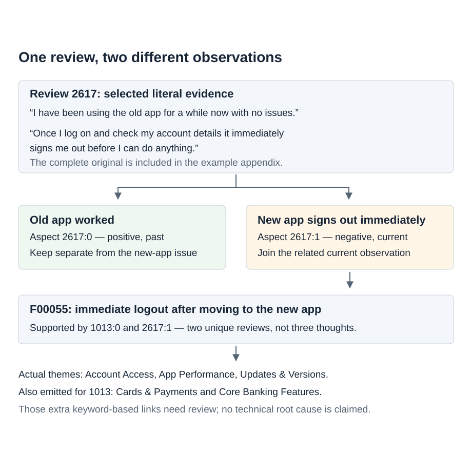

Chattermill — a simple walkthrough

# From customer reviews to useful insights

A short walkthrough of the submitted Chattermill solution. This is a
presentation companion, not a new experiment or a replacement for the
full report.

## 1. What I wanted to solve

The input was 5,000 banking reviews and 15 themes in five categories.
The reviews did not come with labelled answers.

I wanted to answer two different questions: **what specific things are
customers saying?** And **which broad themes do those observations
belong to?**

A topic classifier alone would not answer the first question. “Account
access” is a broad theme. “The new app signs me out immediately” is a
specific observation that a product team can investigate.

## 2. Why I split each review into aspects

An **aspect** is one specific observation. **Sentiment** is the
customer's attitude towards it: positive, negative or neutral.

One review can praise one thing and complain about another. It can also
compare the old app with the new app. Giving the whole review one label
would lose that detail.

I used an LLM to extract observations, their sentiment and an exact
quote. I also kept context: which product the person means, when the
experience happened, and whose experience it is. This six-field format
was my design choice, not a supplied annotation format.

The quote makes an observation easy to inspect. It does not prove that
the interpretation is correct or that the model found every aspect.

## 3. Two outputs, not one chain of labels

After extraction, I separated **insight discovery** from **theme
assignment**.

For insights, I looked for aspects describing the same specific
observation. For themes, I assigned broad labels directly to each
aspect. An aspect can support several themes, or none.

This separation matters: a grouping error should not automatically
spread a theme to every member of a group. Each theme link keeps its
actual supporting aspects.

## 4. Why embeddings and conservative grouping

People can describe the same problem in different words. Embeddings turn
text into vectors, so I can find candidates with similar meaning without
writing a large list of synonyms.

I started with **E5-small-v2 as a practical baseline**. It is compact
and easy to run locally. I did not choose it because it was the newest
model, and I did not assume it was the best model available.

I then compared it with E5-base-v2 to check whether a larger model was
worth the extra cost. Small produces 384-dimensional vectors; base
produces 768. One run on 346 aspects took 0.52 seconds for small and
1.27 seconds for base. This was one measurement, not a robust speed
benchmark.

For grouping, each aspect starts alone. The algorithm repeatedly joins
the closest groups. With **complete linkage**, the distance between two
groups is the largest distance between their members. With **average
linkage**, it is the average distance.

Complete linkage is more cautious: one very different member can prevent
a merge. I preferred that starting point because mixing different
complaints makes an insight misleading. The trade-off is fragmentation:
similar observations can remain separate.

I used cosine distance with a threshold of 0.15, then separated
incompatible context. An LLM reviewed candidates and could split broad
groups or reject unsupported observations. The full result also includes
19 saved, bounded pair merges. Vector similarity alone is not a semantic
guarantee.

## 5. How I checked the choices

I froze 200 reviews: 160 random and 40 difficult examples. I used 100
for development and 100 for confirmation. Each half contained 80 random
and 20 difficult reviews. Confirmation did not change prompts or
parameters.

The sample was a time-and-budget compromise for comparing methods, not a
statistically calculated accuracy benchmark. The complete result still
covers all 5,000 reviews.

| Question | Why I tested it | Decision |
|----|----|----|
| Small or base embeddings? | Check whether more model capacity helps enough to justify it | Keep small: no advantage large enough to meet the frozen switching rule on both halves |
| Complete, average, or LLM-only grouping? | Check the trade-off between mixing different claims and splitting similar claims | Keep the reviewed complete-linkage baseline; LLM-only remained a pilot |
| Dictionary, direct LLM, or group-based mapping? | Check whether grouping improves broad theme assignment | Use direct aspect mapping: simpler, with no stable group-based advantage |

## 6. The grouping result needs care

I compared both embedding models, complete and average linkage, at seven
thresholds: 0.10, 0.12, 0.15, 0.18, 0.20, 0.22 and 0.25. I did not
choose a desired number of groups.

The diagnostic penalised a false merge twice as much as a false split. A
change needed at least five percentage points of improvement on both
halves. That was an engineering policy, not a statistical significance
test.

Some alternatives scored better, but not enough to meet that rule. For
example, base with complete linkage at 0.15 scored 3.2% on development
and 4.0% on confirmation. The retained small baseline scored 4.9% and
8.1%. Lower is better, but these are model-judge disagreement scores,
not accuracy.

The pair sample contained few “same observation” pairs. On development
there were 9 same, 119 different and 22 uncertain pairs. On confirmation
there were 13 same, 117 different and 20 uncertain. Even keeping
everything separate can score deceptively well. This evaluation does not
establish strong recurrence discovery.

This curve uses the full set of saved aspect vectors, before semantic
review. It shows sensitivity to the threshold, not an optimal threshold.

## 7. Why direct theme mapping won the design choice

The dictionary baseline assigns themes using words and phrases. It is
cheap and clear, but it misses unfamiliar wording and context. The LLM
alternatives use the observation and evidence to understand the meaning.

| Method                | Development                     | Confirmation    |
|-----------------------|---------------------------------|-----------------|
| Dictionary            | 46 of 80 reviews flagged: 57.5% | 48 of 80: 60.0% |
| Direct aspect mapping | 18 of 80: 22.5%                 | 18 of 80: 22.5% |
| Group-based mapping   | 18 of 80: 22.5%                 | 18 of 80: 22.5% |

A flagged review has at least one error identified by the model judge.
Twenty uncertain reviews were excluded from each half for all methods.
These numbers are **not accuracy**, and equal totals do not mean
identical predictions.

Group-based mapping did not show a stable advantage. Direct mapping
avoids depending on group summaries, so I chose the simpler design.

## 8. What the final result means

| Number | Meaning |
|----|----|
| 5,000 reviews | All input review IDs accounted for |
| 7,311 aspects | Extracted observations with saved evidence and context |
| 3,816 group records | Includes praise, singletons, general feedback and rejected trace records — not 3,816 proven recurring problems |
| 31 explicit empty results | Different from missing processing; not independently verified as truly aspect-free |
| 174 tests and offline replay | Structural correctness and reproducibility, not semantic accuracy |

I calculate counts from unique supporting review IDs. One review
mentioning a theme several times counts once for that theme. Review IDs
are not necessarily unique people, and past observations must not be
presented as current incident rates.

## 9. What I would improve next

The main limitation is evaluation. The generator and judge used the same
model family. On a repeat check with reversed variant order, 17 of 60
decisions changed. That mixes order effects and run variability, so it
does not prove position bias, but it shows instability.

I would next build a small independent reference set, with enough
same-claim pairs and difficult context cases. I would measure missed
aspects, false merges, false splits and theme errors separately. I would
not add more infrastructure before checking these errors.

The result is a traceable, replayable prototype with explicit
trade-offs. It is not a claim of perfect extraction or independently
measured accuracy.

## 10. Reproduction and supporting detail

The main replay command is
`python -m cm.cli run --mode replay --variant final --out outputs/reproduced`.
It rebuilds the result from saved model responses without an API key.
Replay does not generate new LLM answers.

This page is the final interview walkthrough. The submitted employer ZIP
contains the full source code, saved results, setup instructions and examples.
Other reports in this repository may describe earlier iterations.
